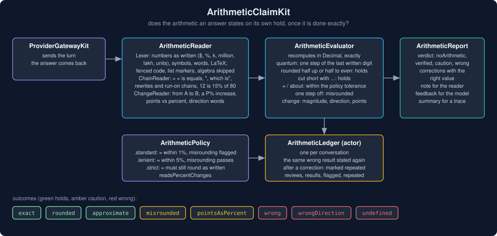
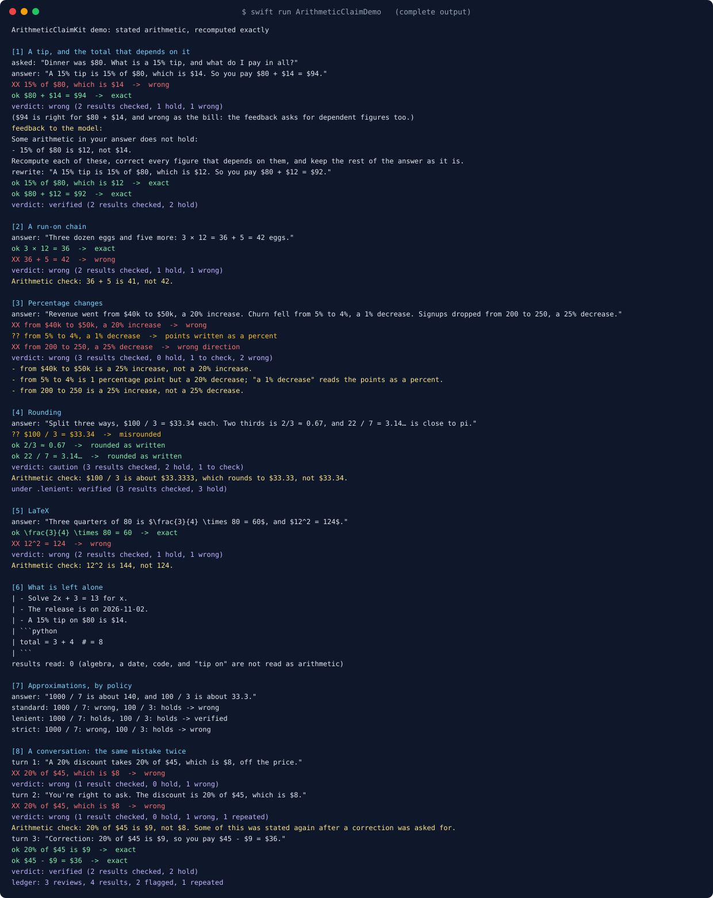
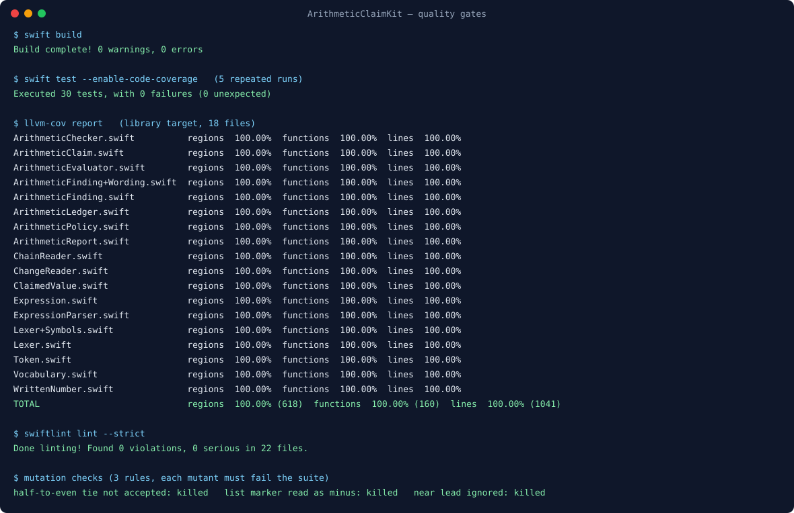

# ArithmeticClaimKit



Someone asks what a 15% tip on an $80 dinner comes to, and the answer says "15% of $80, which is $14, so
you pay $80 + $14 = $94." Another says revenue "went from $40k to $50k, a 20% increase". A third splits
a $100 bill three ways at $33.34 each, and a fourth works through `3 × 12 = 36 + 5 = 42` eggs.

None of these needed a tool or a source. The model did the arithmetic itself, in prose, and got it wrong.
The ORCA benchmark (arXiv 2511.02589, November 2025) put five frontier models through 500 everyday
calculations and found them right 45% to 63% of the time; rounding and precision problems were 34.7% of
the mistakes and plain calculation errors another 33.4%. A wrong figure in a fluent answer reads exactly
like a right one.

ArithmeticClaimKit reads the arithmetic an answer states, recomputes it exactly in `Decimal`, and says which
results hold, which are off in their last digit, and which are wrong, with the right value.

## Why

`NumberBindingKit` already checks figures against evidence: a number that should have come from a tool
result or a source. It has nothing to say when there is no evidence, because the answer computed the
number itself. `CalendarClaimKit` does that for dates. Nothing in this ecosystem did it for plain
arithmetic.

The hard part is reading arithmetic the way a person writes it, and leaving alone what only looks like it:

- `3 × 4 = 12 + 5 = 17` is a run-on chain (12, then 17), while `(3 + 4) × 2 = 7 × 2 = 14` rewrites one
  expression as another. Both are common, and reading one as the other reports a mistake that is not there.
- `2/3 = 0.67` is right to the digits written; `2/3 = 0.66` is not, and `2/3 = 0.666...` is.
- `80 - 15% = 68` takes 15% of 80 away, the way a calculator does.
- "From 40% to 50%, a 10% increase" is 10 percentage points, but a 25% increase.
- `- 3 + 4 = 7` is a list item, `2x + 3 = 13` is algebra, `2026-10-30` is a date, and code in a fence
  computes on its own terms.

## What it gives you

- **`ArithmeticReader`** finds stated results outside fenced code: symbols (`+ - − × x * · / ÷ ^ ²`), words
  (`plus`, `minus`, `times`, `multiplied by`, `divided by`), equality (`=`, `≈`, `~=`, `is`, `equals`,
  `is equal to`, `gives`, `comes to`, `works out to`, `, which is`), approximations (`about`, `roughly`, `~`),
  and LaTeX (`\times`, `\cdot`, `\div`, `\frac{a}{b}`, `\approx`, `\text{...}`, `$...$` and `\(...\)`).
  Numbers keep what they were written with: currency, thousands separators, `%`, `percent`, `per cent`,
  `k`/`M`/`bn`, `thousand`/`million`/`lakh`/`crore`, units, and `...` for digits cut short.
- **Chains.** `a = b = c` is judged step by step. When both sides compute, the reader takes the reading the
  numbers fit (rewrite or run-on), and failing both, the closer one. `12 = 3 × 4` reads either way round;
  `12 is 15% of 80` does too, but `Step 2 is 3 + 4` does not. `48, plus 10 is 58` carries a result on.
- **Changes.** `from A to B` with a percentage and a direction word nearby (`a 25% increase`, `fell 20%`,
  `up 10 percentage points`), stopping at a clause word or another number so "from 40 to 50 while churn
  rose 3%" is not read as one claim.
- **`ArithmeticEvaluator`** recomputes exactly. Each written result has a *quantum*, one step in its last
  written digit (`33.34` is 0.01, `3.6 million` is 100,000, `25%` is 0.01), and the outcome follows from it.
- **`ArithmeticReport`**: a verdict (`noArithmetic`, `verified`, `caution`, `wrong`), `corrections` with the
  right values, a `note` for the reader, a `feedback` message for the model, and a `summary` for a trace.
- **`ArithmeticLedger`** (actor): one per conversation. A wrong result stated again after a correction was
  asked for is marked `isRepeated`, so an app can stop re-asking and show the note instead.
- **`ArithmeticPolicy`**: `.standard` (approximations within 1%, misrounding reported), `.lenient` (5%,
  misrounding let through), `.strict` (an approximation must still round to its digits).

## Usage

```swift
import ArithmeticClaimKit

let ledger = ArithmeticLedger()                    // one per conversation
let report = await ledger.review(answerText)

switch report.verdict {
case .wrong, .caution:
    showUnderTheAnswer(report.note)                // "Arithmetic check: 15% of $80 is $12, not $14."
    if report.repeatedCount == 0, let feedback = report.feedback {
        askForARewrite(feedback)                   // "Recompute each of these, correct every figure
    }                                              //  that depends on them, ..."
case .verified, .noArithmetic:
    log(report.summary)                            // "2 results checked, 2 hold"
}
```

Without a conversation, `ArithmeticChecker(policy:).check(text)` returns the same report.

## How a result is judged

| The exact value, against the result as written | Outcome | Severity |
| --- | --- | --- |
| equal | `exact` | holds |
| rounds to it, half up or half to even, or it is cut short with `...` | `rounded` | holds |
| marked `≈`/`about`, within the policy's tolerance | `approximate` | holds |
| within one step of the last written digit, rounded the wrong way | `misrounded(correct:)` | caution (`.lenient`: holds) |
| a change between two percentages, stated as a percent but equal to the points | `pointsAsPercent(points:)` | caution |
| a change of the right size in the other direction | `wrongDirection` | wrong |
| divides by zero, or a percentage change from zero | `undefined` | wrong |
| anything else | `wrong(correct:)` | wrong |

## Where it sits

- **ProviderGatewayKit** sends the turn; this package checks the answer that comes back.
- **NumberBindingKit** binds figures to evidence; this one checks the figures the answer worked out itself.
- **CalendarClaimKit** does the same for date arithmetic.
- **OutputRepairKit** runs a bounded repair loop; `report.feedback` is the re-prompt.
- **ai-chat-app** runs it as the `arithmeticCheck` stage after the model answers.

## Demo

`swift run ArithmeticClaimDemo` runs eight scenarios with no network and prints 79 lines
([`Screenshots/demo-output.txt`](Screenshots/demo-output.txt)). Two of them:

```text
[1] A tip, and the total that depends on it
    asked: "Dinner was $80. What is a 15% tip, and what do I pay in all?"
    answer: "A 15% tip is 15% of $80, which is $14. So you pay $80 + $14 = $94."
    XX 15% of $80, which is $14  ->  wrong
    ok $80 + $14 = $94  ->  exact
    verdict: wrong (2 results checked, 1 hold, 1 wrong)
    ($94 is right for $80 + $14, and wrong as the bill: the feedback asks for dependent figures too.)
    feedback to the model:
      Some arithmetic in your answer does not hold:
      - 15% of $80 is $12, not $14.
      Recompute each of these, correct every figure that depends on them, and keep the rest of the answer as it is.
    rewrite: "A 15% tip is 15% of $80, which is $12. So you pay $80 + $12 = $92."
    ok 15% of $80, which is $12  ->  exact
    ok $80 + $12 = $92  ->  exact
    verdict: verified (2 results checked, 2 hold)

[3] Percentage changes
    answer: "Revenue went from $40k to $50k, a 20% increase. Churn fell from 5% to 4%, a 1% decrease. Signups dropped from 200 to 250, a 25% decrease."
    XX from $40k to $50k, a 20% increase  ->  wrong
    ?? from 5% to 4%, a 1% decrease  ->  points written as a percent
    XX from 200 to 250, a 25% decrease  ->  wrong direction
    verdict: wrong (3 results checked, 0 hold, 1 to check, 2 wrong)
    - from $40k to $50k is a 25% increase, not a 20% increase.
    - from 5% to 4% is 1 percentage point but a 20% decrease; "a 1% decrease" reads the points as a percent.
    - from 200 to 250 is a 25% increase, not a 25% decrease.
```

The others: a run-on chain, rounding (and the same answer under `.lenient`), LaTeX, what is left alone
(algebra, a date, code, "tip on"), approximations under each policy, and a ledger that marks the same
wrong result stated twice.



## Install

```swift
.package(url: "https://github.com/rajatslakhina/arithmetic-claim-kit.git", from: "1.0.0")
```

Swift tools 6.0, Swift 6 language mode. macOS 13, iOS 16, tvOS 16, watchOS 9. No dependencies.

## Quality gates

All run on this machine (Swift 6.4, SwiftLint 0.63.2), and again on a fresh clone of this repository
after it was pushed:

- `swift build`: 0 warnings, 0 errors.
- `swift test --enable-code-coverage`: 30 tests, 0 failures, green on 5 repeated runs.
- `llvm-cov report`: **100.00%** regions (618), functions (160) and lines (1041) on all 18 library files
  ([`Screenshots/coverage.txt`](Screenshots/coverage.txt)).
- `swiftlint lint --strict`: 0 violations in 22 files, no suppressions.
- Three rules were mutation-checked in a copy, and each mutant fails the suite: accepting only half-up
  rounding at a tie (so `5 / 2 = 2` is reported); reading a line-start `- ` as a minus sign; ignoring a
  run-on lead that is within its last digit.
- Probing with real answer shapes before 1.0.0 found five gaps, each fixed and pinned by a test:
  `$12^2 = 124$` read the LaTeX `$` as a price; `m²` was dropped from a number's text; "is equal to" broke
  a chain; "15% of $80, which is $14" was not read; a `\frac` excerpt lost the command.



## Limits, stated plainly

- **Only what is written as arithmetic.** "A 15% tip on $80 is $14" is not read (only `of`): it could mean
  the tip or the bill, and guessing wrong would report a mistake that is not there. Word problems that
  never write the operation ("three dozen is 42") are not read either.
- **No units.** `12 kg + 3 kg = 15 kg` is checked as numbers. Units are not converted or compared, so
  `2 hours × 30 minutes` is not caught.
- **No algebra, no functions.** Variables, `sqrt`, `log`, fractional and negative exponents, and exponents
  above 12 are left alone, as are `≠`, `<` and `>`.
- **Prose, not code.** Fenced code is skipped; inline code is read.
- **Dependent figures are not traced.** In the demo, `$80 + $14 = $94` holds as arithmetic though `$14` was
  wrong; the feedback asks the model to correct every figure that depends on a wrong one.
- **Change claims need a direction word** near the percentage, within one clause.

## License

MIT. See [LICENSE](LICENSE).
